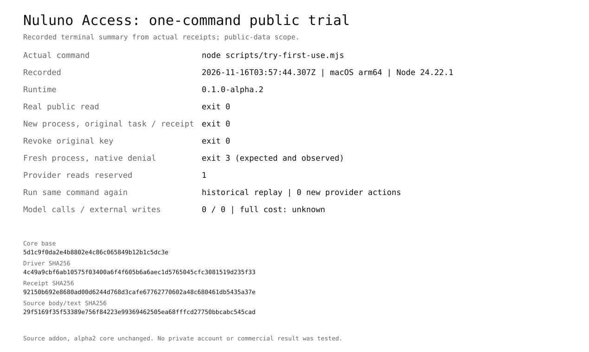

# One command. Read a public post, resume, then revoke.

From a reviewed current source checkout, run:

```sh
node scripts/try-first-use.mjs
```

Requires Node 24 with npm and Internet access. No private mailbox, social account, OAuth consent, model key or paid extension is required for this public-data trial.

For a first installation, obtain and review the source first:

```sh
git clone https://github.com/wangthewhale/nuluno-access-community.git
cd nuluno-access-community
```

Then run the one command above. Preserve an existing checkout/task workspace; do not clone over it or reset its state. This addon lives in current `main`; tagged releases still support the [manual helper](../examples/public-status/README.md).

The command creates an isolated temporary consumer, installs this checkout, and runs the existing alpha2 helper through four separate processes:

1. Read a real public Mastodon post through official MCP and save `status.md` with the source and receipt.
2. Reopen the same task through the SDK. Its one-provider-call quota stays at one.
3. Revoke the original key.
4. Start a fresh service process and require native `access_revoked` denial. Exit 3 is expected for this last helper invocation; the driver exits 0 only after checking the denial and that no replacement key or successful read was substituted.

Results are saved in `nuluno-access-trial/`. Run the same command again to display the saved trial. This is labelled historical and makes zero new provider actions. It does not reauthorize an account or reset a task. If partial output already exists, the driver preserves it and stops; diagnose using the original helper and state.

Your existing install, credentials and task state are not replaced. Reviewed source is copied into a separate private temporary directory; only the new trial writes its own local state. Dependency setup may take several minutes. Its network request count and the complete cost are unknown. A failed source or permission check is not replaced by fixture data.

For an explicitly new public task, choose a new output directory:

```sh
node scripts/try-first-use.mjs --out another-public-trial --status-id 117466985005297414
```

This driver is an addon in current `main`; it is not part of the immutable alpha2 tag. The recorded trial used alpha2 base commit `5d1c9f0da2e4b8802e4c86c065849b12b1c5dc3e` plus the exact driver hash in the [machine receipt](evidence/one-command-first-use-20261116.json). Core, SDK and original helper were unchanged.



[Actual terminal lines](evidence/one-command-terminal-20261116.txt) · [Machine receipt](evidence/one-command-first-use-20261116.json) · [Existing helper and manual procedure](../examples/public-status/README.md)

The verified scope is public reads, original-task reuse and revocation. This does not verify private Gmail, automatic social registration, posting or bypassing a platform's consent/CAPTCHA.
